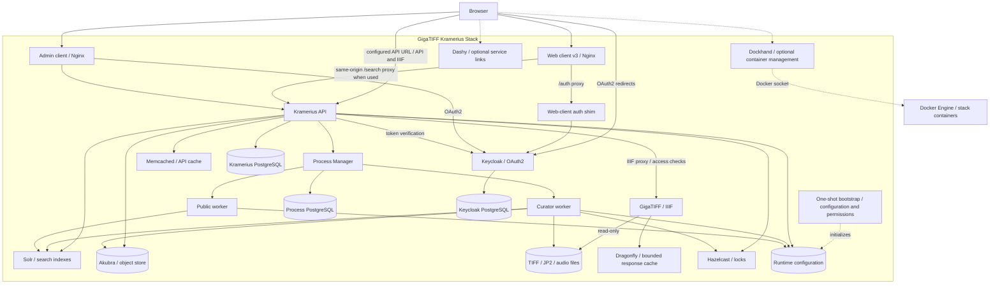

# GigaTIFF Kramerius Stack

This repository contains a reproducible local or LAN test deployment for the
GigaTIFF Kramerius Stack: Kramerius 7.2.2.4 connected to the GigaTIFF IIIF image
server.

It tracks configuration and installation scaffolding only. Runtime databases,
Akubra object-store data, Solr indexes, imported NDK packages, generated JP2
files, logs, caches and temporary files are intentionally ignored.

## Versioning

Stack version means a tested integration bundle. Component versions keep their
own upstream meaning.

Current local candidate (not published to GHCR):

```text
GigaTIFF Kramerius Stack: stack-0.1.18
Runtime directory:          gigatiff-kramerius
```

Compatibility matrix:

```text
Core:
  Kramerius API:            7.2.2.4
  Kramerius web client v3:  3.0.35
  Kramerius admin client:   1.6.2 (cb16f71247d34780604fcc867eb9a884279e48c6)
  GigaTIFF server:          0.3.7 (Grok 20.4.19)
  Web-client auth shim:     0.1

Services:
  Curator worker:           7.2.2.4
  Public worker:            7.2.2.4
  Process manager:          1.5.2
  Solr:                     10.0.0
  Kramerius PostgreSQL:     18.6
  Process PostgreSQL:       18.6
  Keycloak PostgreSQL:      14.24
  Keycloak:                 22.0.11-1.10
  Dragonfly:                2.0.2
  Memcached:                1.6.45 (Debian Trixie)
  Hazelcast locks server:   2.0

Optional tools:
  Dockhand:                 1.0.54
  Dashy:                    4.8.0

Build/runtime bases:
  Rust:                     1.99.1 / Debian Trixie
  Python auth shim:         3.15.1 / Alpine 3.24
  Node admin build:         24.22.1 / Debian Trixie
  Apache admin runtime:     2.4.69 / Debian Trixie
  Debian snapshot:          trixie-20261020-slim
```

The machine-readable source of truth is `versions.toml`.

The latest published GHCR bundle remains `stack-0.1.17` with GigaTIFF `0.3.6`.
The `stack-0.1.18` bundle is prepared for publication from the local workstation,
without GitHub Actions. The lock pins the committed GigaTIFF source; publication
requires clean source checkouts. Keep deployment defaults on the previous
bundle until all five registry uploads have been verified. No release tag or
publish workflow is needed for this local publication path.

`stack-0.1.5` refreshes the GigaTIFF server image to `0.3.1`. That image builds
Grok from upstream commit `06c96bfbc38c74d386ce27018002d3febfff8f0c`, which
fixes the lossy RPCL JP2 region/reduce artefact reproduced during local testing.
The recommended JP2 runtime mode remains the hybrid `auto` mode: OpenJPEG is the
primary decoder and Grok is available as fallback or an explicitly selected
backend.

`stack-0.1.6` upgrades the Kramerius API, curator worker and public worker to
`7.2.1.1`. Upstream release notes mention a new field in the `search` Solr index
for map/georeference search; the schema tracked in this repository was compared
against the `v7.2.1.1` Solr 9 schema and already contains the required fields.
Existing data with maps or georeferences should still be reindexed after the
upgrade so the new index content is populated.

`stack-0.1.7` upgrades the Kramerius web client v3 to `3.0.16-beta`. The
upstream release refreshes audio-recording pages, favorites-list behavior,
accessibility modes, collection display, metadata grouping, and several document
detail edge cases.

`stack-0.1.8` upgrades the Kramerius web client v3 to `3.0.18-beta`. This
upstream release changes the runtime configuration layout: client configuration
files are now served directly from `/local-config/` instead of
`/local-config/<krameriusId>/`. The stack follows that layout, so the GigaTIFF
client configuration is tracked as `public/local-config/config-main.json`,
`public/local-config/config-licenses.json` and
`public/local-config/config-homepage.json`.

`stack-0.1.9` upgrades the Kramerius web client v3 to `3.0.19-beta`. The
upstream release adds optional loading of UI configuration from the Kramerius API
`/ui-config/` endpoints. This stack keeps local `public/local-config/*` files as
the default source of truth and writes `apiConfigBaseUrl: ""` plus
`forceApiConfig: false` into `assets/env.json`; API-loaded configuration can be
enabled later with `APP_API_CONFIG_BASE_URL` and `APP_FORCE_API_CONFIG=true`.
The local `config-main.json` was also aligned with the new upstream config shape
by adding explicit integrations/export settings, `features.showExportHistory`,
the broader document-type list, and `search.facetThreads`.

`stack-0.1.10` upgrades the Kramerius web client v3 to `3.0.20-beta`. The
upstream release focuses on fixes for favorites-list searches, collection data
loading, multivolume-publication search pagination and counts, periodical
filters, year-range validation, mobile reader controls, FAQ display and updated
localization. The runtime configuration shape was checked against the
`trinera/cdk-client:3.0.20-beta` image and remains compatible with the
`stack-0.1.9` local-config layout.

`stack-0.1.11` upgrades the Kramerius API, curator worker and public worker to
`7.2.1.2`. Upstream release notes cover PDF page indexing, map search, SDNNT
license synchronization planning, synchronization process controls and ČDK
worker process changes. The release explicitly requires a Solr schema update and
core/collection reload for map search; this stack updates the tracked `search`
schema with the new exact-search, path-hierarchy, author-role and spatial fields.

`stack-0.1.12` upgrades the Kramerius web client v3 to `3.0.21-beta`. The
upstream release focuses on mobile-layout refinements, reader responsiveness,
page-search fixes, PDF viewer alignment, filter dialog loading behavior and CDK
source filtering. The runtime configuration shape was checked against
`trinera/cdk-client:3.0.21-beta`; this stack keeps local static configuration,
the same-origin auth bridge, the terms/login fallback and the square-corner UI
override.

`stack-0.1.13` upgrades the Kramerius web client v3 to `3.0.22-beta` and the
GigaTIFF server image to `0.3.2`. The web-client release refreshes visual
styling, switches the upstream font family to IBM Plex, adjusts dark-mode and
high-contrast behavior, improves dynamic search placeholders, source-library
selection and reader link handling. The local configuration shape remains
compatible with the previous stack. GigaTIFF `0.3.2` rebuilds the server image
with Grok `v20.3.9`, including upstream decompressor fixes while keeping the
hybrid JP2 `auto` backend policy.

`stack-0.1.14` upgrades the Kramerius web client v3 to `3.0.23-beta` and the
GigaTIFF server image to `0.3.3`. The web-client release continues the IBM Plex
typography cleanup, fixes applying some settings changes, reorganizes right
sidebar metadata, adds alternative title and ISMN display, and improves
convolute search/reader behavior. GigaTIFF `0.3.3` rebuilds the server image
with Grok `v20.3.10`.

`stack-0.1.15` upgrades the Kramerius API and both workers to `7.2.2.1`, the
web client to `3.0.29`, the required admin client to `1.6.2`, Process Manager
to `1.5.2`, and GigaTIFF to `0.3.4` with Grok `20.4.9`. It also updates
Dragonfly to `1.40.2`, the Kramerius and Process Manager PostgreSQL services to
`18.6`, and the Keycloak PostgreSQL service to the latest compatible PostgreSQL
14 patch release, `14.24`. The Keycloak database deliberately remains on major
version 14 for this bundle; moving it to a newer PostgreSQL major requires a
separate dump/restore migration.

Kramerius 7.2.2 introduces KAPP licence synchronization, so this stack adds the
`kapp-sync` Solr core from the upstream `v7.2.2.1` `installation.zip`. Its
managed schema replaces the removed Solr 10 `LowerCaseTokenizerFactory` with a
standard tokenizer followed by a lowercase filter. The existing GigaTIFF
search-schema fixes remain in place. Existing collections should be reindexed
when the new `containsLicenses` data is required. GigaTIFF `0.3.4` passed 60
Linux unit tests and a 30-case JP2 pixel comparison against both OpenJPEG and
Grok 20.3.10 before being pinned here.

`stack-0.1.16` upgrades the Kramerius API and both workers to `7.2.2.3`, the
web client to `3.0.30`, and GigaTIFF to `0.3.5` with Grok `20.4.12`.
Kramerius includes statistics-logging, OCR encoding, collection, IIIF-resource
and indexer fixes; the curator worker image is also smaller. The web-client
release reduces IIIF tile requests and improves immediate rendering, mobile
panels, watermarks, search snippets and document actions. The upstream
Kramerius `solr-9.x` directories from `7.2.2.1` and `7.2.2.3` were compared
file by file and are identical, so this maintenance update needs no Solr schema
replacement or reindex by itself. GigaTIFF passed all 60 Linux tests plus two
36-case JP2 pixel suites against OpenJPEG and Grok `20.4.9`; the hybrid `auto`
backend remains the default after first-load benchmarking.

`stack-0.1.17` upgrades the web client to `3.0.32`, GigaTIFF to `0.3.6`
with Grok `20.4.15`, and Dragonfly to `2.0.0`. The client includes the
`3.0.31` and `3.0.32` reader, IIIF tile, metadata, search and favorites fixes.
The upstream local-config shape was compared with `3.0.30`; no mandatory
JSON migration is needed for this single-library deployment. The stack retains
local configuration, the same-origin auth bridge, terms/login fallback,
GigaTIFF favicon and square-corner override, without replacing upstream light
or dark palettes. Kramerius API/workers, Solr and all PostgreSQL versions are
unchanged; this bundle itself does not require a schema update or reindex.

Before publication, Grok `20.4.15` passed all 60 Linux unit tests, all 36 JP2
pixel comparisons against OpenJPEG (maximum channel delta 1), and all 36
comparisons against Grok `20.4.12` with exact pixel equality. The suite covers
six small/medium JP2 files, including the earlier lossy RPCL regression;
the multi-gigabyte map masters are not included in this run. Dragonfly `2.0.0`
restored all 884 keys from a copy of the previous snapshot and passed response
cache hit/miss, byte-equality, per-identifier purge, TTL and readiness checks.

`stack-0.1.18` updates Kramerius and both workers to `7.2.2.4`, the web
client to `3.0.35`, and GigaTIFF to `0.3.7` with Grok `20.4.19`. It also
updates Dragonfly, Memcached, optional tools, Rust dependencies and build bases
to the versions listed above. The upstream Kramerius comparison contains no
Solr schema changes, so existing local schema fixes remain intact.

PostgreSQL healthchecks now wait for the final TCP listener, not the temporary
Unix-socket server used during `initdb`. All databases have a cold-start grace
period, and Keycloak/Kramerius/bootstrap wait for database health. This avoids
starting application services while first-run database initialization is still
in progress on a busy workstation.

The web client adds lock-based licences. Local configuration explicitly sets
`locks.idleTimeoutSec: 600` and `locks.warningSec: 60`; actual licence names,
reader limits and lock intervals remain controlled by Kramerius. The existing
disabled analytics/map integrations, same-origin auth bridge, terms/login,
branding and square-corner override are retained. Dragonfly's new daily version
check also sends deployment telemetry, so the stack explicitly disables it with
`--version_check=false`, retaining the 2 GiB bounded cache configuration.

The login-shortcut fallback now recognizes the English `Log in` and `Sign in`
labels, including wrapped whitespace. Otherwise it would overlap the native
header button in English. Seven dependency-free regression tests cover the
English/Czech labels, hidden native controls and existing sessions:

```powershell
node --test scripts/tests/login-shortcut.test.cjs
```

Local candidate verification used a fresh, empty Compose project on Docker
Desktop, not the ZimaBoard installation. Bootstrap completed with all five Solr
cores (`search`, `processing`, `logs`, `sdnnt-sync`, `kapp-sync`) and no core
initialization failures. The bootstrap probe for the logs core now checks its
actual `date` field instead of the nonexistent `created` field. API version,
anonymous user access, a Keycloak token followed by authenticated API access,
the terms page and the login redirect were checked. No digital documents were
imported. Dragonfly 2.0.2 passed response miss/hit and byte equality, per-image
purge, TTL expiry and readiness checks.

GigaTIFF's local Linux workspace passed 67 tests. The six-file JP2 suite passed
36 direct-Grok and 36 hybrid comparisons against OpenJPEG with maximum channel
delta 1; an executor-only comparison passed all 36 with exact pixel equality.
The large `mapa2` masters were not available on this PC. A controlled follow-up
isolated the first-load slowdown to Grok's embedded Mercury path, not the Rust
dependency refresh. The server image now defaults to `GRK_MERCURY=0`, retaining
classic Grok FFI and the hybrid `auto` backend policy. Its rebuilt image passed
all 36 comparisons against the previous Grok reference with exact pixel equality.
See the [GigaTIFF investigation report](https://github.com/bezverec/gigatiff/blob/e55904db3c1160b047f8d7d41ee88b50c01e95a6/docs/benchmarks/2026-10-22-grok.md)
for the benchmark matrix and limitations. Override the image environment with
`GRK_MERCURY=1` only for an explicit comparison. Large masters, other coding
modes and native-Linux load still need deployment-specific validation.

PostgreSQL 18.6/14.24, Solr 10.0.0, Process Manager 1.5.2, admin client 1.6.2,
the Czech Keycloak 22.0.11-1.10 image and Hazelcast 2.0 remain the latest releases
in their selected distributions/compatible lines as checked on 2026-10-22.
This does not mean Keycloak 22 is current upstream. Its replacement, together
with the PostgreSQL 14 database migration (support ends 2026-11-12), requires a
separate backed-up integration upgrade. Node stays on the Angular-compatible
24 line rather than adopting an unsupported newer major.

## What This Stack Starts

- Kramerius 7.2.2.4 API and workers.
- Separate PostgreSQL databases for Kramerius, Keycloak and the process manager.
- Solr 10 with user-managed cores.
- Keycloak for OAuth2 authentication.
- A small web-client auth shim for Keycloak login/token/logout routes.
- Kramerius web client with GigaTIFF branding.
- Kramerius admin client.
- GigaTIFF IIIF image server with Dragonfly response cache.
- Optional Dockhand and Dashy helper tools.

## Component Architecture



The browser loads the frontend from Nginx and calls the configured Kramerius API
URL for API and IIIF requests. Nginx also provides a same-origin `/search` proxy
and the `/auth` bridge; the selected API origin depends on runtime configuration.
Kramerius performs document access checks before forwarding image requests to
GigaTIFF. The image server reads the image directory without write access.
Akubra object storage, image files, databases, Solr indexes and cache volumes are
runtime data, not image contents. Bootstrap initializes configuration and
permissions once; it is not a continuously running service. Dashy only links to
services, while Dockhand has privileged access to the Docker socket and should
be limited to trusted administrators. Solid arrows show runtime communication;
dotted arrows show setup and optional management paths.

## Repository Layout

- `docker-compose.yml` - core Kramerius, Solr, Keycloak, workers, web client and admin client.
- `docker-compose.gigatiff.yml` - optional integrated GigaTIFF image server and Dragonfly cache.
- `docker-compose.tools.yml` - optional Dockhand and Dashy tools.
- `docker-compose.clean.yml` - clean-stack override for Buildah-built local images and bootstrap.
- `docker-compose.ghcr.yml` - clean-stack override for prebuilt GHCR images.
- `versions.toml` - stack version, component pins and GHCR image names.
- `Containerfile.clean-bootstrap` - small Debian Trixie bootstrap image for post-start checks and SQL helpers.
- `Dockerfile.auth-shim` - small Python auth bridge used by the web client.
- `mnt/import/.kramerius4` - Kramerius runtime configuration mounted into API and workers.
- `mnt/containers/solr/data` - Solr core configuration only, not generated indexes.
- `public/local-config` - web-client runtime configuration.
- `public/favicon.svg` - GigaTIFF favicon mounted into the web client.
- `ops/admin-client` - Docker build wrapper for the required admin client.
- `ops/auth-shim` - OAuth2 login/token/logout bridge for web-client v3.
- `ops/bootstrap` - clean-stack bootstrap entrypoint.
- `ops/web-client` - GigaTIFF web-client CSS and login fallback assets.
- `ops/keycloak/kramerius-realm.json` - disposable test realm import for Keycloak.
- `ops/dockhand/register-stack.sh` - Dockhand stack registration helper.
- `ops/dashy/conf.yml` - Dashy dashboard configuration.
- `ops/sql/grant-public-read.sql` - local test permission helper for public IMG_FULL access.
- `ops/sql/normalize-process-owners.sql` - local process manager owner cleanup helper.
- `scripts/build-clean-images.sh` - Buildah image builder for the clean stack.
- `scripts/build-ghcr-images.sh` - Buildah image builder using the public GHCR image tags.
- `scripts/prepare-clean-stack.sh` - creates a clean install directory from Git-managed files only.
- `scripts/configure-endpoints.*` - helpers for switching between localhost and LAN URLs.
- `scripts/grant-public-read.*` - helpers for applying the public read permission SQL.
- `scripts/normalize-process-owners.*` - helpers for fixing process owner JSON compatibility.

## Prerequisites

Install:

- Buildah on the Linux host that will build the clean local images.
- Docker with Compose v2.
- Git.
- PowerShell 7 or a POSIX shell, depending on which helper scripts you use.

Clone the required repositories side by side. Keep the source checkout and the
runtime deployment directory clearly separated; the examples use
`gigatiff-kramerius-stack-src` for the Git checkout and `gigatiff-kramerius`
for the live Compose stack.

```bash
mkdir services
cd services
git clone https://github.com/bezverec/gigatiff.git
git clone https://github.com/bezverec/gigatiff-kramerius-stack.git gigatiff-kramerius-stack-src
git clone https://github.com/ceskaexpedice/kramerius-admin-client.git
cd gigatiff-kramerius-stack-src
```

Expected layout:

```text
services/
  gigatiff/
  gigatiff-kramerius-stack-src/
  kramerius-admin-client/
```

The admin client checkout is required because the clean Buildah workflow builds
it from `../kramerius-admin-client`.

## Default Install

The preferred Linux installation path is the clean Buildah stack. Windows local
builds use the same clean configuration and Dockerfiles, as described below.

Do not copy a running Kramerius directory to create a new install. A live
directory may contain PostgreSQL data, Solr indexes, Akubra object-store files,
converted JP2 files, logs and caches. The Buildah workflow creates fresh images
and a fresh stack directory from Git-managed configuration only.

The clean workflow includes:

- Kramerius configuration.
- Solr schema fixes.
- Keycloak realm import.
- GigaTIFF-branded web-client files.
- Web-client login bridge for Keycloak.
- Integrated GigaTIFF image server and Dragonfly cache.
- Admin-client build output.
- Bootstrap checks and local test SQL helpers.

It deliberately excludes:

- imported NDK packages,
- generated JP2/TIFF image payloads,
- Akubra object-store data,
- PostgreSQL data,
- Solr index data,
- GigaTIFF response cache,
- logs or temporary files.

From the repository checkout, prepare a clean runtime directory:

```bash
./scripts/prepare-clean-stack.sh /home/bezverec/services/gigatiff-kramerius
cd /home/bezverec/services/gigatiff-kramerius
```

Configure endpoint URLs for the target host:

```bash
./scripts/configure-endpoints.sh 10.0.120.30 0.0.0.0
```

If another Kramerius stack is already running on the same host, set alternate
ports before running the helper:

```bash
WEB_CLIENT_PORT=2234 \
ADMIN_CLIENT_PORT=2235 \
KRAMERIUS_API_PORT=28088 \
KRAMERIUS_DEBUG_PORT=25005 \
KRAMERIUS_AJP_PORT=28009 \
KEYCLOAK_PORT=28990 \
SOLR_PORT=28983 \
LOCK_SERVER_PORT_1=25701 \
LOCK_SERVER_PORT_2=25702 \
LOCK_SERVER_PORT_3=25703 \
PROCESS_MANAGER_PORT=28082 \
CURATOR_WORKER_PORT=28084 \
PUBLIC_WORKER_PORT=28086 \
KRAMERIUS_DB_PORT=60432 \
PROCESS_DB_PORT=60433 \
GIGATIFF_PORT=38082 \
DOCKHAND_PORT=23000 \
DASHY_PORT=28080 \
./scripts/configure-endpoints.sh 10.0.120.30 0.0.0.0
```

Build clean local images with Buildah. The build script reads `.env`, so run
endpoint configuration before this step:

```bash
./scripts/build-clean-images.sh
```

The script builds:

```text
localhost/gigatiff-kramerius-web-client:clean
localhost/gigatiff-kramerius-auth-shim:clean
localhost/gigatiff-kramerius-admin-client:clean
localhost/gigatiff-kramerius-bootstrap:clean
```

By default, it also publishes those images into the local Docker daemon so
Docker Compose can run them. Set `PUSH_TO_DOCKER=0` if you only want Buildah
storage images.

### GHCR Images

The same stack can use prebuilt images from GitHub Container Registry instead
of local Buildah images.

Published image names for `stack-0.1.17`:

```text
ghcr.io/bezverec/gigatiff-kramerius-web-client:stack-0.1.17
ghcr.io/bezverec/gigatiff-kramerius-auth-shim:stack-0.1.17
ghcr.io/bezverec/gigatiff-kramerius-admin-client:stack-0.1.17
ghcr.io/bezverec/gigatiff-kramerius-bootstrap:stack-0.1.17
ghcr.io/bezverec/gigatiff-server:0.3.6
```

To publish them from GitHub Actions, run the `Publish GHCR Images` workflow or
push a tag named like `stack-0.1.17`. The workflow reads `versions.toml`, checks
out the pinned admin client and GigaTIFF revisions, builds Linux `amd64` images,
adds OCI metadata, and publishes SBOM/provenance attestations.

To build the same tags locally with Buildah:

```bash
./scripts/build-ghcr-images.sh
```

By default this builds the GHCR-tagged images and also publishes them into the
local Docker daemon. To push to GHCR from a logged-in Buildah session:

```bash
buildah login ghcr.io
PUSH_TO_GHCR=1 ./scripts/build-ghcr-images.sh
```

To run the stack from GHCR images instead of local Buildah images, add
`docker-compose.ghcr.yml` after the clean and GigaTIFF files and explicitly
disable local builds:

```bash
docker compose \
  -f docker-compose.yml \
  -f docker-compose.clean.yml \
  -f docker-compose.gigatiff.yml \
  -f docker-compose.ghcr.yml \
  up -d --pull always --no-build
```

The admin-client image is runtime-configured from `.env`, so the same GHCR image
works for localhost and LAN deployments.

Start the clean stack, including the GigaTIFF image server:

```bash
docker compose \
  -f docker-compose.yml \
  -f docker-compose.clean.yml \
  -f docker-compose.gigatiff.yml \
  up -d
```

Run the bootstrap checks and disposable test permission helpers:

```bash
docker compose \
  -f docker-compose.yml \
  -f docker-compose.clean.yml \
  --profile bootstrap run --rm clean-bootstrap
```

`clean-bootstrap` waits for PostgreSQL, Solr, Keycloak and the Kramerius API,
checks that the Solr schema contains the fields required by our fixes, verifies
that the `kramerius` realm exists, applies `ops/sql/grant-public-read.sql`, and
applies `ops/sql/normalize-process-owners.sql`.

The clean stack imports the test Keycloak realm automatically from:

```text
ops/keycloak/kramerius-realm.json
```

The imported disposable user is:

```text
username: krameriusAdmin
password: krameriusAdmin
```

When you want to include the optional helper tools in the same clean deployment,
compose the tools file as well:

```bash
docker compose \
  -f docker-compose.yml \
  -f docker-compose.clean.yml \
  -f docker-compose.gigatiff.yml \
  -f docker-compose.tools.yml \
  --profile tools up -d
```

Use a new target directory for every clean deployment. Do not run
`prepare-clean-stack.sh` over a directory that already contains a live database,
Solr index or imported documents.

## Local Windows Builds Without Actions

Buildah remains the default Linux build path. On Windows, the same Dockerfiles
can be built with Docker Desktop in Linux-container mode, without Actions,
WSL shell scripts or a registry login. Use a Docker Desktop installation with
the containerd image store so local images retain SBOM/provenance attestations.
This builds Linux `amd64` containers, not desktop ZIP releases.

Keep `gigatiff`, this stack checkout and `kramerius-admin-client` side by side.
The admin checkout must be clean and match the exact ref in `versions.toml`
(currently tag `v1.6.2`). GigaTIFF is deliberately built from the current local
worktree; its workspace version must match the lock. This permits testing an
uncommitted candidate without pretending it is a published immutable release.

```powershell
.\scripts\build-local-images.ps1 -BuildJobs 4
```

The script reads TOML with Python in a container, refreshes base images by
default, builds all five images and loads them into the local Docker engine.
Without `-Publish`, it never pushes images. Neither mode creates Git tags,
invokes Actions, prunes Docker data or changes running services. The local aliases used by `docker-compose.clean.yml`
are updated locally:

```text
localhost/gigatiff-kramerius-web-client:clean
localhost/gigatiff-kramerius-auth-shim:clean
localhost/gigatiff-kramerius-admin-client:clean
localhost/gigatiff-kramerius-bootstrap:clean
gigatiff-server:local
```

Versioned local tags use `stack-0.1.18` and server `0.3.7`; they do not exist
on GHCR yet. Logs, Buildx metadata and `images.json` live under ignored
`.local-build/<timestamp>/`, including source revisions, dirty-worktree flags
and image IDs. Select a subset with `-Components web-client,auth-shim`;
use `-SkipPull` only when deliberately reusing already resolved base images.
No host Python installation is required.

### Publish From Windows

After local verification, publish directly from Docker Desktop without using
GitHub Actions. First commit the GigaTIFF source, update `core.gigatiff_ref` in
`versions.toml` to that exact commit, and commit the stack. Push both source
commits to their repositories before publishing. The script rejects dirty
worktrees and a GigaTIFF revision that differs from the lock.

Authenticate interactively with a GitHub personal access token (classic) with
`write:packages`; do not put the token into scripts, logs or command arguments:

```powershell
docker login ghcr.io -u bezverec
.\scripts\build-local-images.ps1 -Publish -BuildJobs 4
```

`-Publish` replaces the local export with a registry push, retains SBOM and
provenance attestations, and records and verifies each remote image digest.
Only the five custom images are uploaded; databases, imported documents and
caches are not part of the images. The platform is Linux `amd64`, not a
multi-architecture release. It does not deploy or restart any running stack.
Keep the previous published tags in deployment defaults until all five uploads
have been verified, then update the GHCR override, `.env.example` and both
endpoint configuration helpers together.

For a loopback-only Docker Desktop test, keep Keycloak's browser URL and its
Docker-network alias consistent:

```powershell
.\scripts\configure-endpoints.ps1 -PublicHost 127.0.0.1 `
  -KeycloakPublicHost keycloak.localhost -KeycloakPort 8990
```

Browsers resolve `keycloak.localhost` to loopback, while containers resolve the
same name through the existing Docker network alias. Use port `8990` on both
sides for this setup. `127.0.0.1` in the backend's `keycloak.json` would instead
refer to the Kramerius container itself, breaking authenticated API calls even
when the browser can obtain a token. For LAN deployments, retain the reachable
host address and port configured by **Default Install**.

Reuse the configuration steps in **Default Install**, then run the prepared
runtime with `docker-compose.clean.yml` and `up -d --no-build`. Do not use the
GHCR override for local candidate tags: its `pull_policy: always` deliberately
requires published images. The last published tags and GHCR defaults stay at
`stack-0.1.17` / `0.3.6` until publication is explicitly requested.

GigaTIFF's complete Linux test suite can also run locally without exporting a
large builder image:

```powershell
docker buildx build --target verify --output type=cacheonly `
  --build-arg GIGATIFF_BUILD_JOBS=4 ..\gigatiff
```

## Configuration

The clean stack is configured by `.env` plus mounted configuration files under
`mnt/import/.kramerius4`, `public/local-config` and `rewrite.config`.

Generate `.env` with `scripts/configure-endpoints.*`.

For a localhost-only workstation:

```bash
./scripts/configure-endpoints.sh 127.0.0.1 127.0.0.1
```

For a LAN host, for example ZimaBoard at `10.0.120.30`:

```bash
./scripts/configure-endpoints.sh 10.0.120.30 0.0.0.0
```

PowerShell equivalent:

```powershell
.\scripts\configure-endpoints.ps1 -PublicHost 10.0.120.30 -BindAddr 0.0.0.0
```

The helper updates:

- `.env`
- `mnt/import/.kramerius4/configuration.properties`
- `mnt/import/.kramerius4/keycloak.json`
- `mnt/import/.kramerius4/migration.properties`
- `public/local-config/config-main.json`
- `public/local-config/libraries.json`
- `rewrite.config`

The helper deliberately keeps two GigaTIFF addresses:

- `GIGATIFF_INTERNAL_BASE_URL` is written into `migration.properties` and is
  used by Kramerius and worker containers during import and image proxying.
- `http://<KRAMERIUS_PUBLIC_HOST>:<GIGATIFF_PORT>/iiif/3` is written into
  `rewrite.config` for browser-facing legacy IIP rewrites.

For the clean stack, keep `docker-compose.gigatiff.yml` running on
`GIGATIFF_PORT`. Imported Akubra datastreams store
`GIGATIFF_INTERNAL_BASE_URL`; if that URL points to
`host.docker.internal:<GIGATIFF_PORT>` but no GigaTIFF server listens there,
ordinary search endpoints can still return 200 while thumbnails, `IMG_FULL` and
`/search/iiif/.../info.json` return HTTP 500.

On Docker Desktop, the default internal URL is
`http://host.docker.internal:18082/iiif/3`. If you run the integrated GigaTIFF
service on the same Compose network and want containers to talk directly, set:

```bash
export GIGATIFF_INTERNAL_BASE_URL=http://gigatiff-server:8080/iiif/3
./scripts/configure-endpoints.sh 127.0.0.1 127.0.0.1
```

PowerShell equivalent:

```powershell
.\scripts\configure-endpoints.ps1 `
  -PublicHost 127.0.0.1 `
  -BindAddr 127.0.0.1 `
  -GigaTiffInternalBaseUrl http://gigatiff-server:8080/iiif/3
```

### Keycloak

The clean Buildah stack imports realm `kramerius` automatically from:

```text
ops/keycloak/kramerius-realm.json
```

The imported realm contains:

- public client `krameriusClient`,
- roles `common_users`, `public_users`, `kramerius_admin` and `k4_admins`,
- disposable user `krameriusAdmin` with password `krameriusAdmin`.

The test realm deliberately uses longer local-development session limits than
the Keycloak defaults:

```text
Access token lifespan:       3600 seconds
SSO session idle timeout:    28800 seconds
SSO session max lifespan:    86400 seconds
Client session idle timeout: 28800 seconds
Client session max lifespan: 86400 seconds
Login code lifespan:         1800 seconds
```

This avoids repeated automatic logout during longer Admin UI import and metadata
editing sessions.

Kramerius reads its Keycloak client settings from:

```text
mnt/import/.kramerius4/keycloak.json
mnt/import/.kramerius4/configuration.properties
```

The expected values are:

```properties
keycloak.realm=kramerius
keycloak.clientId=krameriusClient
keycloak.tokenurl=http://keycloak.localhost:8990/realms/kramerius/protocol/openid-connect/token
```

For a LAN clean stack, the generated token URL uses the LAN host instead, for
example:

```properties
keycloak.tokenurl=http://10.0.120.30:28990/realms/kramerius/protocol/openid-connect/token
```

and:

```json
{
  "realm": "kramerius",
  "auth-server-url": "http://keycloak.localhost:8990/",
  "resource": "krameriusClient",
  "verify-token-audience": false,
  "bearer-only": true,
  "public-client": true
}
```

`keycloak.localhost` is intentional for local Docker use: it is resolvable from
both the host browser and the Kramerius container when the browser runs on the
same machine. For LAN deployments, the endpoint helper defaults
`KEYCLOAK_PUBLIC_HOST` to `KRAMERIUS_PUBLIC_HOST`, for example
`10.0.120.30`, so OAuth redirects are reachable from other computers.

Override `KEYCLOAK_PUBLIC_HOST` explicitly only when Keycloak should be exposed
through a different DNS name or reverse proxy.

### Development Compose Workflow

The plain Compose workflow is kept for development and debugging only. It is not
the preferred clean installation path.

Use it when iterating on Compose files or local configuration in the repository
checkout:

```bash
docker compose up -d --build
```

Watch startup:

```bash
docker compose ps
docker compose logs -f --tail=100 kramerius
```

The first start can take a while because databases and Solr cores need to
initialize.

For a fresh machine, also check that the process manager and both workers are
running. Imports can be scheduled from the admin client even when workers are not
yet polling correctly:

```bash
docker compose ps processManager curatorWorker publicWorker
docker compose logs --tail=100 processManager curatorWorker publicWorker
```

If you use the development workflow without `docker-compose.clean.yml`, create
or import the Keycloak realm manually or adapt the clean realm import override
for your local workflow.

## GigaTIFF Server

If you already run GigaTIFF elsewhere, keep it listening on the configured
`GIGATIFF_PORT`, default `18082`.

To run the integrated GigaTIFF image server next to Kramerius:

```bash
docker compose \
  -f docker-compose.yml \
  -f docker-compose.clean.yml \
  -f docker-compose.gigatiff.yml \
  up -d --build gigatiff-server
```

The integrated GigaTIFF compose uses:

- Dragonfly response cache.
- `jpeg2000-grok-ffi` server feature.
- cache namespace `gigatiff-server-response-v12-jp2-auto-fix`.
- OpenJPEG FFI for full-resolution JP2 tiles and Grok FFI for reduced JP2 tiles.

Check readiness:

```bash
curl "http://127.0.0.1:${GIGATIFF_PORT:-18082}/readyz"
curl "http://127.0.0.1:${GIGATIFF_PORT:-18082}/metrics"
```

## Optional Tools

Dockhand provides a lightweight Docker UI. Dashy provides a link dashboard.
Dashy browser links point to `127.0.0.1`, while its status checks use Docker
service names so they work from inside the Dashy container.

Run the tools from the clean stack directory so they join the same Compose
project and Docker network as Kramerius.

Start both:

```bash
docker compose -f docker-compose.tools.yml --profile tools up -d
```

If you want to start the clean stack, GigaTIFF and the tools in one command,
use:

```bash
docker compose \
  -f docker-compose.yml \
  -f docker-compose.clean.yml \
  -f docker-compose.gigatiff.yml \
  -f docker-compose.tools.yml \
  --profile tools up -d
```

Stop them:

```bash
docker compose -f docker-compose.tools.yml --profile tools down
```

Dashy config lives in:

```text
ops/dashy/conf.yml
```

Each Dashy item has two URLs:

- `url` is the browser-facing localhost URL opened when you click the item.
- `statusCheckUrl` is the container-facing URL used by Dashy health checks.

For example, the web client opens as `http://127.0.0.1:1234` in your browser,
but Dashy checks it from inside Docker as `http://web-client/`. If Dashy shows a
service as down while the browser link works, check that the service name in
`statusCheckUrl` matches the Compose service and that the tools were started
from this repo directory. Services from optional profiles, such as GigaTIFF, are
expected to show as down until that profile is running.

Dockhand gets the local compose stack registered automatically by
`dockhand-init`. The repo is mounted into the Dockhand container at:

```text
/workspace/gigatiff-kramerius
```

The registered stack points Dockhand at:

```text
/workspace/gigatiff-kramerius/docker-compose.yml
```

For the clean Buildah stack, add `docker-compose.clean.yml` in Dockhand when you
edit the registered stack.

If a `.env` file exists in the repository root, `dockhand-init` registers it as:

```text
/workspace/gigatiff-kramerius/.env
```

The Docker socket is mounted into Dockhand, so it should manage the local Docker
daemon directly. If Dockhand shows connection errors, first check:

```bash
docker compose -f docker-compose.tools.yml --profile tools logs dockhand-init
docker compose -f docker-compose.tools.yml --profile tools logs dockhand
```

`dockhand-init` is idempotent. Re-run it after changing stack paths or the `.env`
file:

```bash
docker compose -f docker-compose.tools.yml --profile tools up dockhand-init
```

If you deploy on a LAN host, update URLs in `ops/dashy/conf.yml` or regenerate
endpoint config first and adapt the dashboard manually.

Portainer is intentionally not part of this stack. Use Dockhand for this test
deployment to keep the operations surface small.

## Service URLs

With default localhost settings:

- Web client: `http://127.0.0.1:1234`
- Admin client: `http://127.0.0.1:1235`
- Kramerius API: `http://127.0.0.1:8088`
- Keycloak: `http://127.0.0.1:8990`
- Solr: `http://127.0.0.1:8983`
- GigaTIFF: `http://127.0.0.1:18082`
- Dockhand: `http://127.0.0.1:3000`
- Dashy: `http://127.0.0.1:18080`

For a LAN deployment, replace `127.0.0.1` with `KRAMERIUS_PUBLIC_HOST`.

Example ports used for the side-by-side ZimaBoard clean stack:

- Web client: `http://10.0.120.30:2234`
- Admin client: `http://10.0.120.30:2235`
- Kramerius API: `http://10.0.120.30:28088`
- Keycloak: `http://10.0.120.30:28990`
- Solr: `http://10.0.120.30:28983`

## Import Test Data

Put NDK import packages into:

```text
mnt/import/.kramerius4/convert
```

Generated conversion output is written under:

```text
mnt/imageserver/iip-data
```

Those directories are ignored by Git.

The import configuration is set for IIIF Image API 3 URLs:

```properties
convert.useImageServer=true
convert.imageServerTilesURLPrefix=http://host.docker.internal:18082/iiif/3
convert.imageServerImagesURLPrefix=http://host.docker.internal:18082/iiif/3
convert.imageServerSuffix.removeFilenameExtensions=false
convert.imageServerSuffix.tiles=
convert.imageServerSuffix.big=/full/max/0/default.jpg
convert.imageServerSuffix.thumb=/full/,128/0/default.jpg
convert.imageServerSuffix.preview=/full/,700/0/default.jpg
convert.imageServerDirectory=/mnt/imageserver/iip-data
convert.imageServerDirectorySubfolders=true
```

`convert.imageServerSuffix.tiles` must stay empty. Kramerius appends
`/info.json` itself when proxying IIIF tiles. If the stored `tiles-url` already
contains `/info.json`, Kramerius will request `.../info.json/info.json` and the
viewer will fail.

When an import finishes, check the follow-up index process as well as the import
process. A successful conversion can still be followed by a failed reindex if
Solr rejects a field:

```bash
docker compose logs --tail=200 curatorWorker
docker compose logs --tail=200 solr
```

If the admin client process list fails with `JSONObject["owner"] not a string.`,
run the owner normalization helper before retrying the process view:

```bash
./scripts/normalize-process-owners.sh
```

## Post-Install Public Access

After the first Kramerius boot and before testing public full-image access, run:

```bash
./scripts/grant-public-read.sh
```

PowerShell equivalent:

```powershell
.\scripts\grant-public-read.ps1
```

This applies `ops/sql/grant-public-read.sql`, granting root `a_read` to
`common_users` if it is missing. Without it, anonymous users may see thumbnails
but receive 403 for `IMG_FULL` or IIIF `info.json`.

## Local Fixes and Compatibility Notes

This test stack contains a few deliberate local fixes. They are part of the
reproducible setup, not accidental generated state.

### Solr 10 schema

The Solr configuration under:

```text
mnt/containers/solr/data
```

is tracked in Git on purpose. Do not replace it with a freshly generated empty
Solr core.

The file:

```text
mnt/containers/solr/data/MUST_BE_SYNC_WITH_PROJECT.txt
```

documents that the local Solr config should stay in sync with the upstream
Kramerius Solr 9.x installation profile:

```text
https://github.com/ceskaexpedice/kramerius/tree/master/installation/solr-9.x
```

The most important core for the web client is:

```text
mnt/containers/solr/data/search/conf/managed-schema
```

It includes fields used by the Kramerius/CDK web client detail and periodical
views, for example:

- `pid`
- `model`
- `accessibility`
- `root.pid`
- `own_parent.pid`
- `date.str`
- `date.min`
- `part.number.str`
- `issue.type.code`
- `licenses`
- `contains_licenses`
- `licenses.facet`

It also includes fields emitted by the Kramerius 7.2 indexer and by the
upstream Solr 9.x profile, for example:

- `authors.aut.facet`
- `authors.aut.identifiers`
- `coords.is_point`
- `coords.bbox`
- `date_instant.year`
- `subject_names_personal.search`
- `subject_names_corporate.facet`
- `subject_temporals.search`
- `subtype`

It also keeps copy rules used by license facets:

```xml
<copyField source="contains_licenses" dest="licenses.facet"/>
<copyField source="licenses" dest="licenses.facet"/>
<copyField source="licenses_of_ancestors" dest="licenses.facet"/>
```

If the schema is incomplete, the web client can load the root object but fail on
children/facet queries with HTTP 500 responses from Kramerius. A typical failing
query asks Solr for fields such as `date.str`, `own_parent.pid`,
`issue.type.code`, `licenses` or sorts by `date.min`. Import or reindex jobs can
also fail with Solr `unknown field` errors for newer indexer fields such as
`authors.aut.facet`, `authors.aut.identifiers` or spatial fields such as
`coords.bbox`.

When changing Solr schema files:

1. Stop Kramerius and Solr.
2. Keep `mnt/containers/solr/data/*/conf/managed-schema` under version control.
3. Remove generated Solr indexes only if you want a clean reindex.
4. Start Solr and Kramerius again.
5. Reindex or reimport affected objects.

For a quick schema sanity check:

```bash
grep -n 'own_parent.pid\|date.str\|licenses.facet\|authors.aut.identifiers\|coords.bbox\|subject_names_personal.search' \
  mnt/containers/solr/data/search/conf/managed-schema
```

The Czech Hunspell dictionary files referenced by `managed-schema` are tracked
with the Solr config so a fresh Solr core can start without missing analyzer
resources.

Kramerius `7.2.2` also adds the `kapp-sync` core. The upstream installation
archive uses `solr.LowerCaseTokenizerFactory`, which is no longer available in
Solr 10. The tracked `kapp-sync/conf/managed-schema` preserves its behavior with
`solr.StandardTokenizerFactory` followed by `solr.LowerCaseFilterFactory`.
Without this compatibility fix the core fails with `Error loading parsing
schema` and `ClassNotFoundException: solr.LowerCaseTokenizerFactory`.
`clean-bootstrap` verifies that the core loads and exposes its required `id`
field.

The `logs` core configuration is tracked as well. Kramerius writes access and
DNNT statistics there when documents and pages are opened. Its schema keeps
`date.str` as a string, year fields as integers and an `*_str` dynamic field for
Solr's schemaless copy-field processor. Without this, page access can still work
but Kramerius logs repeated Solr 500 errors such as:

```text
copyField dest :'date.str_str' is not an explicit field and doesn't match a dynamicField.
```

### Public `IMG_FULL` access

`ops/sql/grant-public-read.sql` is an idempotent local test helper. It grants
root `a_read` to `common_users`.

This fixes the local-test situation where thumbnails are visible, but anonymous
users are still denied full images and IIIF `info.json` with HTTP 403.

Apply it after the first boot:

```bash
./scripts/grant-public-read.sh
```

### Process manager owner JSON compatibility

Kramerius admin client expects process `owner` values to be strings. Local or
manual process calls can leave older rows with `owner` as `NULL` or empty, which
can surface in the admin client as:

```text
JSONObject["owner"] not a string.
```

Normalize existing rows after a clean rebuild or after manual process-manager
API calls:

```bash
./scripts/normalize-process-owners.sh
```

PowerShell equivalent:

```powershell
.\scripts\normalize-process-owners.ps1
```

### IIIF image URL suffixes

`mnt/import/.kramerius4/migration.properties` stores image-server URL suffixes.
The important values are:

```properties
convert.imageServerSuffix.tiles=
convert.imageServerSuffix.big=/full/max/0/default.jpg
convert.imageServerSuffix.thumb=/full/,128/0/default.jpg
convert.imageServerSuffix.preview=/full/,700/0/default.jpg
```

`convert.imageServerSuffix.tiles` must stay empty because Kramerius appends
`/info.json` when proxying IIIF tile metadata. If `/info.json` is stored in the
datastream already, requests can become `.../info.json/info.json`.

### Legacy IIP rewrite rules

`rewrite.config` maps old IIP-style requests to GigaTIFF IIIF Image API 3 URLs.
This lets Kramerius paths that still call `/fcgi-bin/iipsrv.fcgi` resolve to the
same JP2 files served by GigaTIFF.

Examples:

```text
FIF=...&HEI=128&CVT=jpeg  -> /iiif/3/.../full/,128/0/default.jpg
FIF=...&HEI=700&CVT=jpeg  -> /iiif/3/.../full/,700/0/default.jpg
FIF=...&CVT=jpeg          -> /iiif/3/.../full/max/0/default.jpg
iiif=.../info.json        -> /iiif/3/.../info.json
```

Run `scripts/configure-endpoints.*` again after changing the public host,
because it rewrites GigaTIFF URL prefixes in `rewrite.config`.

### Truncated thumbnail URLs

Some imported thumbnail URLs were observed to reach GigaTIFF as:

```text
/iiif/3/<identifier>/full/
```

instead of the complete:

```text
/iiif/3/<identifier>/full/,128/0/default.jpg
```

GigaTIFF contains a compatibility fallback for that truncated Kramerius
thumbnail form and treats it as a 128-pixel-high JPEG thumbnail. Without that
fallback, Kramerius reports thumbnail HTTP 500 errors because GigaTIFF correctly
rejects the incomplete IIIF URL with HTTP 400.

### Web client favicon and proxy behavior

The web client image is built through `Dockerfile.web-client-gigatiff` and uses:

```text
web-client-entrypoint.sh
web-client-nginx.conf
public/favicon.svg
public/local-config
ops/web-client/gigatiff-square.css
ops/web-client/gigatiff-login-shortcut.js
```

The entrypoint injects local runtime URLs and replaces the upstream favicon with
the GigaTIFF SVG. The nginx config proxies `/search/` to Kramerius and serves
legacy favicon paths from the same SVG to avoid stale browser icon references.

The entrypoint also injects a small GigaTIFF UI override. It keeps the current
web client functional, but makes the local test build visually sharper by
removing most rounded corners and by adding a visible login fallback button when
the upstream header does not render one. The fallback follows the upstream CDK
flow: from regular pages it opens `/pages/terms?returnUrl=...`, and from the
terms page it starts OAuth login through `/auth/login`.

### Web client auth bridge

The Kramerius web client v3 beta expects these same-origin routes:

```text
/auth/login
/auth/token
/auth/logout
```

Kramerius 7.2.x exposes a different authentication facade, so the stack runs a
small `auth-shim` service built from `Dockerfile.auth-shim`. The web-client
nginx configuration proxies both `/auth/*` and
`/search/api/client/v7.0/auth/*` to this shim.

The shim:

- redirects `/auth/login` to the configured Keycloak realm,
- exchanges `code` for tokens through the internal Keycloak URL,
- refreshes tokens through the same Keycloak token endpoint,
- redirects `/auth/logout` to Keycloak logout,
- exposes `/auth/healthz` for quick checks.

The public redirect target is controlled by:

```env
KEYCLOAK_PUBLIC_HOST=10.0.120.30
KEYCLOAK_PORT=8990
WEB_CLIENT_PORT=1234
```

For a LAN deployment, the expected quick check is:

```bash
curl http://127.0.0.1:1234/auth/healthz
curl -D - -o /dev/null "http://127.0.0.1:1234/auth/login?redirect_uri=http%3A%2F%2F10.0.120.30%3A1234%2Fauth%2Fcallback"
```

## Admin Client Notes

The stack expects `../kramerius-admin-client` to exist before `docker compose up`.

The admin build uses:

```text
ops/admin-client/Dockerfile.gigatiff
```

It injects local GigaTIFF and Kramerius URLs into:

```text
assets/shared/globals.js
```

If the public host or ports change, rerun `scripts/configure-endpoints.*` and
rebuild the admin client:

```bash
docker compose up -d --build admin-client
```

## Troubleshooting

Check stack status:

```bash
docker compose ps
docker compose logs --tail=100 kramerius
```

Check Keycloak:

```bash
docker compose ps keycloak_eduid
curl http://127.0.0.1:8990
```

Check web-client login bridge:

```bash
docker compose ps auth-shim web-client
curl http://127.0.0.1:1234/auth/healthz
curl -D - -o /dev/null "http://127.0.0.1:1234/auth/login?redirect_uri=http%3A%2F%2F127.0.0.1%3A1234%2Fauth%2Fcallback"
curl -fsS http://127.0.0.1:1234/ | grep -E 'gigatiff-square|gigatiff-login-shortcut'
```

Check GigaTIFF:

```bash
curl http://127.0.0.1:18082/readyz
curl http://127.0.0.1:18082/metrics
```

If login redirects still use `keycloak.localhost` from a LAN browser, or the web
client login button sends users to an unreachable host, rerun the endpoint
helper with the LAN host and restart Keycloak, Kramerius, auth-shim and the web
client:

```bash
./scripts/configure-endpoints.sh 10.0.120.30 0.0.0.0
docker compose -f docker-compose.yml -f docker-compose.clean.yml up -d keycloak_eduid kramerius auth-shim web-client admin-client
```

For the side-by-side ZimaBoard clean stack, keep the alternate ports in `.env`
when rerunning the helper.

Use one browser hostname consistently during login. Mixing `127.0.0.1`,
`localhost`, `keycloak.localhost` and a LAN IP in the same login flow can leave
stale Keycloak cookies and produce:

```text
Cookie not found. Please make sure cookies are enabled in your browser.
```

If that happens, close old login tabs, clear cookies for the Keycloak host you
are using, rerun `scripts/configure-endpoints.*` with the intended public hosts,
and rebuild/restart `web-client`, `admin-client`, `keycloak_eduid` and
`kramerius`.

If the web client still shows MZK/CDK data, verify the runtime config served by
the local nginx container:

```bash
curl http://127.0.0.1:1234/local-config/libraries.json
curl http://127.0.0.1:1234/local-config/config-main.json
```

The browser console should report that configuration was loaded for library
`gigatiff`, and API calls should go to `http://127.0.0.1:8088`, or to your
configured `KRAMERIUS_PUBLIC_HOST`. If not, rerun `scripts/configure-endpoints.*`,
rebuild `web-client`, and hard-refresh the browser.

If thumbnails load but the main image returns 403, apply:

```bash
./scripts/grant-public-read.sh
```

If IIIF `info.json` returns 500 and logs show a URL ending in
`info.json/info.json`, verify:

```properties
convert.imageServerSuffix.tiles=
```

Then re-import the affected object or patch existing Akubra FOXML datastreams.

If small thumbnails return 500 and Kramerius logs show a GigaTIFF URL ending in
`/full/`, make sure GigaTIFF includes the compatibility fallback for truncated
Kramerius thumbnail URLs.

## Upgrades

Treat upgrades as clean rebuilds unless you intentionally want to preserve
runtime databases and imported documents.

Recommended upgrade flow:

```bash
cd /home/bezverec/services/gigatiff-kramerius-stack-src
git pull --ff-only
./scripts/prepare-clean-stack.sh /home/bezverec/services/gigatiff-kramerius-new
cd /home/bezverec/services/gigatiff-kramerius-new
./scripts/configure-endpoints.sh 10.0.120.30 0.0.0.0
./scripts/build-clean-images.sh
docker compose \
  -f docker-compose.yml \
  -f docker-compose.clean.yml \
  -f docker-compose.gigatiff.yml \
  up -d
docker compose \
  -f docker-compose.yml \
  -f docker-compose.clean.yml \
  --profile bootstrap run --rm clean-bootstrap
```

For side-by-side testing, use alternate ports as shown in `Default Install`.
After the new stack is verified, switch external routing or bookmarks to the new
ports. Keep the previous stack directory until the new one is confirmed.

If an intentional in-place upgrade adds a new bind-mounted Solr core, grant the
Solr container write access before restarting it. Clean installs already do
this in `prepare-clean-stack.sh`:

```bash
chmod -R a+rwX mnt/containers/solr/data/<new-core>
```

Without this step the schema can load successfully while core creation still
fails with `AccessDeniedException: /var/solr/data/<new-core>/data`.

When changing Kramerius, Solr, Keycloak or admin-client versions:

- update `versions.toml`,
- update image tags in the Compose files,
- rebuild the Buildah images,
- republish GHCR images when the tested bundle changes,
- run `docker compose config --quiet`,
- run `clean-bootstrap`,
- check Solr logs for schema/index incompatibilities,
- reimport or reindex test documents if the Solr schema changed.

Do not copy old `mnt/containers/*` database or Solr index directories into a
clean upgrade unless you are explicitly testing an in-place data migration.

## Stop and Cleanup

Stop containers without deleting data:

```bash
docker compose -f docker-compose.yml -f docker-compose.clean.yml down
docker compose -f docker-compose.gigatiff.yml down
docker compose -f docker-compose.tools.yml --profile tools down
```

Runtime data lives under:

```text
mnt/
logs/
temp/
cache/
```

Delete those directories only when you intentionally want a fresh test instance.

## Local Test Credentials

These credentials are disposable and must not be reused in production:

- PostgreSQL Kramerius: `fedoraAdmin/fedoraAdmin`
- PostgreSQL process manager: `process/process`
- Keycloak admin: `keycloakAdmin/keycloakAdmin`
- Example Keycloak/Kramerius admin user: `krameriusAdmin/krameriusAdmin`

For production-like testing, replace all passwords, restrict bind addresses and
review every public port before exposing the stack.
